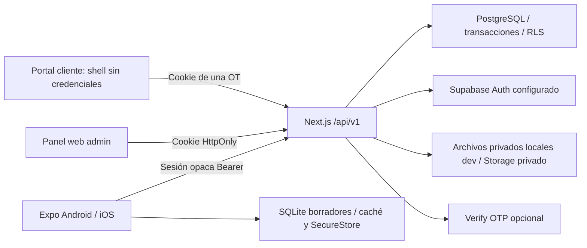

# Arquitectura V1

`packages/domain` define validadores Zod, transiciones, etiquetas, progreso por peso y cálculo monetario. `apps/web/src/lib/orders.ts` coordina casos de uso y consultas parametrizadas; Route Handlers autorizan/validan y traducen errores sin exponer SQL. `apps/mobile` es React Native, no WebView. TanStack Query gestiona consultas/invalidez nativas; SQLite conserva caché y solicitudes pendientes exactas. `apps/web` conserva la landing demo y añade panel/portal.

## Contratos operativos

| Ruta                                                             | Contrato                                                                                                                                           |
| ---------------------------------------------------------------- | -------------------------------------------------------------------------------------------------------------------------------------------------- |
| POST `/api/v1/admin/session` / `session/native`                  | `{email?,password}`; cookie web o token opaco nativo; Auth real si está configurado; contraseña de entorno solo desarrollo                         |
| POST `session/recover`, `session/reset`                          | Recuperación Supabase para la cuenta provisionada; respuesta genérica; cambio invalida sesiones de la app                                          |
| GET/PATCH `/api/v1/admin/config`                                 | Información pública real del negocio y modo Auth; modificación solo admin, incluye plantillas/plazos                                               |
| GET/POST `/api/v1/admin/customers`; PATCH/DELETE `customers/:id` | Cliente normalizado, vehículos e historial; historial impide eliminación directa                                                                   |
| GET/POST `/api/v1/admin/work-orders`                             | Listado con bloqueos/avance real; ingreso vehículo y OT distintos; creación nativa con clave de idempotencia                                       |
| GET `work-orders/:id`                                            | Detalle interno autorizado: tareas, cotizaciones, piezas, QA, medios y eventos                                                                     |
| POST `work-orders/:id/transition`                                | Estado principal + motivo + `expectedVersion` + UUID `idempotencyKey`                                                                              |
| POST `work-orders/:id/actions`                                   | Unión Zod: tareas, notas, ETA, bloqueos, presupuesto/decisión presencial, piezas/recepción, QA, entrega y privacidad de foto; mismas versión/clave |
| POST/DELETE `work-orders/:id/share`                              | Rotación/revocación de enlaces de una orden; revocación serializada con decisiones                                                                 |
| POST `work-orders/:id/media`; GET `/admin/media/:id`             | Imagen validada/recomprimida, clave de carga idempotente y acceso admin                                                                            |
| GET `/t/:token`                                                  | Valida/rate-limit, canje por cookie y redirect a URL limpia                                                                                        |
| GET `/api/v1/public?orderId=UUID`                                | Proyección explícita; verifica grant de esa orden antes de ETag/304                                                                                |
| GET `/api/v1/public/media/:id?exp=...&sig=...`                   | Firma temporal + cookie válida + orden + visibilidad actual                                                                                        |
| POST `/api/v1/public/verification`, `/decision`                  | OTP ligado a grant/presupuesto; versión/idempotencia, límites de intentos y consumo único                                                          |

Las mutaciones de OT toman un lock transaccional de idempotencia y luego de orden. Mismo UUID/cuerpo devuelve el resultado anterior; otro cuerpo genera 409; versión desactualizada genera 409. El evento append-only, auditoría, incremento de versión y outbox se guardan en la misma transacción. La app no reintenta cambios críticos en segundo plano ni inventa éxito ante pérdida de red.

Flujo: recepción → diagnóstico → aprobación opcional → reparación → QA → listo → entregado. Los bloqueos son paralelos, con motivos. Repuesto conforme resuelve su bloqueo; una promesa no lo hace. QA fallido agrega tareas de retrabajo y vuelve a reparación, conservando inspecciones. La OT cerrada rechaza cambios; otro servicio/corrección requiere nueva orden. Los presupuestos se sellan después de insertar sus líneas y no admiten cambios de alcance/importes; nuevas versiones exigen nueva decisión.

## Lectura y medios

El portal entrega una estructura visual sin leer credenciales en el árbol RSC: evita que el diagnóstico de desarrollo serialice cookies. Obtiene datos solo por API autorizada. Polling de 20 segundos mientras la página está visible, ETag por versión/ventana de fotos y estado explícito de desconexión. Una sesión revocada oculta el expediente al refrescar; los medios comprueban revocación en cada solicitud.

El almacenamiento local de imágenes se limita a desarrollo. Producción requiere bucket privado configurado; las URLs de la app expiran a los cinco minutos y no sirven sin la cookie correcta. La service role se usa solo en la capa Storage del servidor; no se serializa al cliente.

## Ajustes de validación para piloto

Fase 2: ingreso/OT tienen barreras de recuperación; fallar la lectura no habilita sobrescribir una cola desconocida. Las notas locales incluyen `dirty` y `baseVersion`; el refresh solo actualiza notas limpias. La primera edición mantiene la versión del contenido mostrado, incluso si se adelanta al efecto de refresh. Los borradores heredados sin versión se conservan como conflictos. El reemplazo de foto persiste primero y elimina después; campos y navegación del ingreso se bloquean durante permisos/picker/guardado para no restaurar snapshots viejos.

El perfil `pilot` genera release APK sin Metro y con modo offline diagnóstico explícito, separado del perfil conectado `preview`. No utiliza un endpoint inventado, no restaura bearer ni intenta tráfico. SQLite diagnóstica y clave SecureStore son distintas del almacenamiento del taller. La inspección Supabase preparada solo lee metadatos dentro de READ ONLY y consulta GET settings con la clave pública; la service role no se envía en esa consulta. Los gates por destino permiten comprobar DB sin EAS/host y servidor sin cuenta móvil.

La migración 007 conserva SELECT sujeto a RLS y revoca DML de `authenticated`, `anon` y PUBLIC sobre las 24 tablas propias. Las escrituras pasan por la API de servidor y sus transiciones/idempotencia, evitando que un cliente Supabase con perfil admin salte QA o decisiones. No modifica tablas ajenas; provisiona privilegios de service_role solo si existe. La rama SQL del rol servidor se ejerce localmente con CRUD y privilegios sobre 24 tablas, dentro de una transacción revertida; la integración Supabase real sigue pendiente.

Auth y Storage validan origen Supabase HTTPS sin usuario, ruta, query o fragmento; solo desarrollo acepta loopback HTTP. Fetch rechaza redirects antes de reenviar secretos. PostgreSQL comparte configuración de TLS verificado entre web y migrador; rechaza overrides SSL de URL. Aprobación pública usa `clock_timestamp()` tras locks y tras Verify, revalidando challenge y grant antes de persistir.

La app usa variantes development/pilot/production con bundle, package y scheme distintos. Pilot/production exigen API HTTPS y ATS estricto; no hay permisos de micrófono ni backup Android. EAS define development client, simulador iOS y preview interno, sin iniciar distribución. El runner piloto carga un archivo explícito y valida controles antes de migrar/compilar/iniciar, sin sustituir el entorno local. E2E usa `.next-e2e` y tsconfig propio para aislar artefactos de build.

El APK1 EAS procede de `0e18590`; contiene manifiesto Android, DEX y `assets/index.android.bundle`, sin Metro. Fuente/artefacto y pruebas quedan separados: el build pasó, la firma se verificó localmente y el propietario reportó las comprobaciones nativas en Android. El perfil posterior `pilot-simulator` hereda el modo diagnóstico y fuerza simulador iOS sin development client; solo se validó configuración y exportación JS, sin lanzar un build Apple ni generar certificados.

## Outbox y reversión

Los eventos generan entradas únicas `(event_id,channel)` en `notification_outbox` para futuras notificaciones. En V1 compartir es una intención explícita del teléfono; no hay worker que envíe WhatsApp/email automáticamente. Un adaptador futuro debe recibir una clave estable `event_id:channel`, reclamar entradas con `FOR UPDATE SKIP LOCKED`, persistir intentos/resultado, usar backoff y no bloquear la transacción del taller. No marcar una entrada enviada sin confirmación del proveedor. No se afirma que ese despacho futuro esté implementado.

Migraciones 003–006 son aditivas; no eliminan historiales. Su reversión operativa requiere restaurar un respaldo de DB compatible; no se promete un down destructivo. El esquema incluye restricciones de QA antes de listo/entregado, cotizaciones selladas y dependencias de tareas dentro de una misma orden. Las dependencias solo se seleccionan al crear la tarea desde otra existente, lo que evita ciclos; no se completa una tarea antes de su predecesora ni se reabre una predecesora con dependientes completados. Las pruebas se ejecutan en una base aislada y se eliminan solo sus fixtures/almacenamiento temporal.
