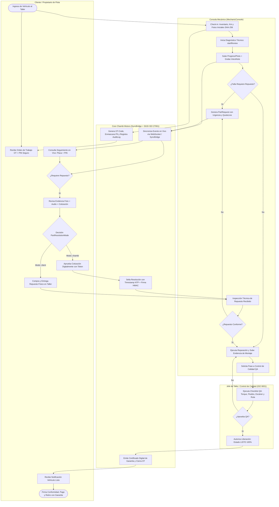
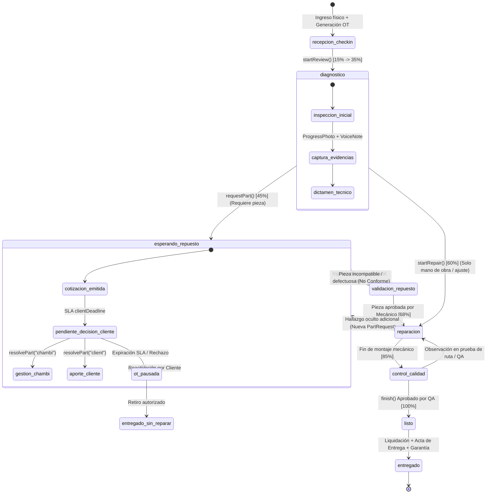
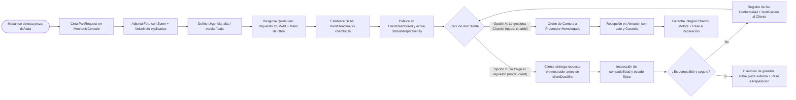
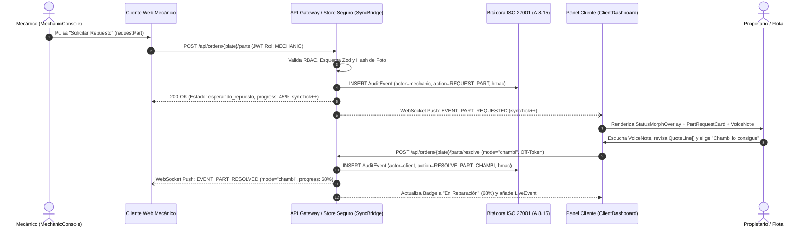
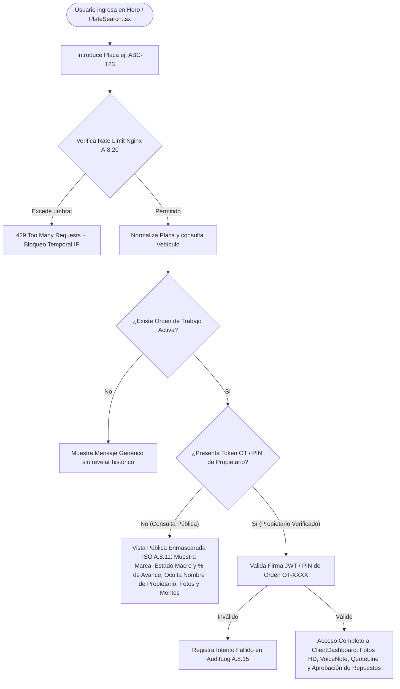
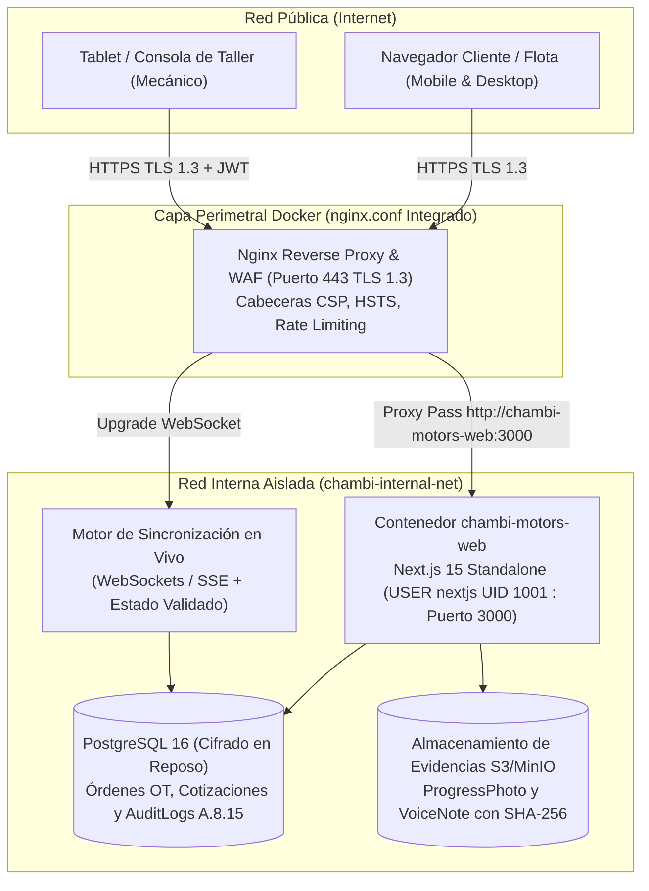

# Auditoría Profunda, Documentación Normativa ISO/IEC 27001 y Megaprompt Maestro para Antigravity — Proyecto Chambi Motors

**Repositorio auditado:** [Elias040720/Chambi-motors](https://www.google.com/search?q=https%3A%2F%2Fgithub.com%2FElias040720%2FChambi-motors)  
**Estándares aplicados:** [ISO/IEC 27001:2022](https://www.google.com/search?q=https%3A%2F%2Fwww.iso.org%2Fstandard%2F27001), [ISO/IEC 27002:2022](https://www.google.com/search?q=https%3A%2F%2Fwww.iso.org%2Fstandard%2F75652.html), [ISO/IEC 12207:2017](https://www.google.com/search?q=https%3A%2F%2Fwww.iso.org%2Fstandard%2F63712.html), [ISO/IEC 25010:2023](https://www.google.com/search?q=https%3A%2F%2Fwww.iso.org%2Fstandard%2F78176.html), [ISO/IEC/IEEE 29148:2018](https://www.google.com/search?q=https%3A%2F%2Fwww.iso.org%2Fstandard%2F72089.html) e [ISO 9001:2015](https://www.google.com/search?q=https%3A%2F%2Fwww.iso.org%2Fstandard%2F62085.html)  
**Entorno de ejecución objetivo:** Agente de desarrollo autónomo **Antigravity** (generación dual en `.md` y `.html`)

---

## 1. Análisis Técnico y Arquitectónico Profundo del Proyecto (Estado Actual «As-Is»)

El proyecto [Chambi-motors](https://www.google.com/search?q=https%3A%2F%2Fgithub.com%2FElias040720%2FChambi-motors) es una plataforma web interactiva de **transparencia operativa y seguimiento en vivo de órdenes de trabajo automotrices ("Seguimiento en Vivo")** que conecta en tiempo real la consola técnica del mecánico con el panel de seguimiento del propietario del vehículo o gestor de flota.

### 1.1 Stack Tecnológico y Configuración Base

| Capa / Categoría | Tecnología Implementada | Versión en Repositorio | Archivo Fuente / Evidencia | Rol en el Sistema Actual |
| :--- | :--- | :--- | :--- | :--- |
| **Framework Core** | Next.js (App Router, `output: "standalone"`) | `^15.5.28` | [package.json](https://www.google.com/search?q=https%3A%2F%2Fgithub.com%2FElias040720%2FChambi-motors%2Fblob%2Fmain%2Fpackage.json) / [next.config.mjs](https://www.google.com/search?q=https%3A%2F%2Fgithub.com%2FElias040720%2FChambi-motors%2Fblob%2Fmain%2Fnext.config.mjs) | Renderizado híbrido y empaquetado de servidor Node autónomo. |
| **Librería UI** | React + React DOM (TypeScript Strict) | `^19.3.1` | [package.json](https://www.google.com/search?q=https%3A%2F%2Fgithub.com%2FElias040720%2FChambi-motors%2Fblob%2Fmain%2Fpackage.json) / [tsconfig.json](https://www.google.com/search?q=https%3A%2F%2Fgithub.com%2FElias040720%2FChambi-motors%2Fblob%2Fmain%2Ftsconfig.json) | Componentes reactivos, hooks personalizados y estado en cliente. |
| **Estilos y Diseño** | Tailwind CSS v4 + PostCSS + `clsx` | `^4.3.3` | [src/app/globals.css](https://www.google.com/search?q=https%3A%2F%2Fgithub.com%2FElias040720%2FChambi-motors%2Fblob%2Fmain%2Fsrc%2Fapp%2Fglobals.css) / [postcss.config.mjs](https://www.google.com/search?q=https%3A%2F%2Fgithub.com%2FElias040720%2FChambi-motors%2Fblob%2Fmain%2Fpostcss.config.mjs) | Sistema de diseño industrial oscuro con tokens semánticos por estado. |
| **Animación y Scrollytelling** | GSAP + Framer Motion + Lenis | `^3.15.0` / `^14.2.0` / `^1.3.26` | [src/lib/gsap.ts](https://www.google.com/search?q=https%3A%2F%2Fgithub.com%2FElias040720%2FChambi-motors%2Fblob%2Fmain%2Fsrc%2Flib%2Fgsap.ts) / [src/components/providers/SmoothScrollProvider.tsx](https://www.google.com/search?q=https%3A%2F%2Fgithub.com%2FElias040720%2FChambi-motors%2Fblob%2Fmain%2Fsrc%2Fcomponents%2Fproviders%2FSmoothScrollProvider.tsx) | Transiciones de etapas, puente de sincronización visual y desplazamiento fluido. |
| **Iconografía** | Lucide React | `^1.57.0` | [package.json](https://www.google.com/search?q=https%3A%2F%2Fgithub.com%2FElias040720%2FChambi-motors%2Fblob%2Fmain%2Fpackage.json) | Iconografía semántica de diagnóstico (`search`), repuestos (`package`), taller (`wrench`) y entrega (`check`). |
| **Contenerización** | Docker (`node:20-alpine`) + Docker Compose | Node 20 Alpine | [Dockerfile](https://www.google.com/search?q=https%3A%2F%2Fgithub.com%2FElias040720%2FChambi-motors%2Fblob%2Fmain%2FDockerfile) / [docker-compose.yml](https://www.google.com/search?q=https%3A%2F%2Fgithub.com%2FElias040720%2FChambi-motors%2Fblob%2Fmain%2Fdocker-compose.yml) | Construcción multi-etapa (`base`, `deps`, `builder`, `runner`) y orquestación en puerto `3000:80`. |
| **Servidor Web (Huérfano)** | Nginx (`nginx.conf`) | N/A | [nginx.conf](https://www.google.com/search?q=https%3A%2F%2Fgithub.com%2FElias040720%2FChambi-motors%2Fblob%2Fmain%2Fnginx.conf) | Configurado para SPA estática (`/usr/share/nginx/html`), pero actualmente desconectado del `Dockerfile`. |

### 1.2 Inventario Completo de Módulos, Componentes y Estado

El código fuente bajo [src/](https://www.google.com/search?q=https%3A%2F%2Fgithub.com%2FElias040720%2FChambi-motors%2Ftree%2Fmain%2Fsrc) se organiza en **4 capas funcionales** y **23 componentes especializados**:

| Dominio / Directorio | Archivos del Repositorio | Responsabilidad Funcional y Flujo de Datos |
| :--- | :--- | :--- |
| **1. Núcleo de Datos y Tipos (`src/lib/`)** | [types.ts](https://www.google.com/search?q=https%3A%2F%2Fgithub.com%2FElias040720%2FChambi-motors%2Fblob%2Fmain%2Fsrc%2Flib%2Ftypes.ts), [data.ts](https://www.google.com/search?q=https%3A%2F%2Fgithub.com%2FElias040720%2FChambi-motors%2Fblob%2Fmain%2Fsrc%2Flib%2Fdata.ts), [status.ts](https://www.google.com/search?q=https%3A%2F%2Fgithub.com%2FElias040720%2FChambi-motors%2Fblob%2Fmain%2Fsrc%2Flib%2Fstatus.ts), [site.ts](https://www.google.com/search?q=https%3A%2F%2Fgithub.com%2FElias040720%2FChambi-motors%2Fblob%2Fmain%2Fsrc%2Flib%2Fsite.ts), [gsap.ts](https://www.google.com/search?q=https%3A%2F%2Fgithub.com%2FElias040720%2FChambi-motors%2Fblob%2Fmain%2Fsrc%2Flib%2Fgsap.ts), [utils.ts](https://www.google.com/search?q=https%3A%2F%2Fgithub.com%2FElias040720%2FChambi-motors%2Fblob%2Fmain%2Fsrc%2Flib%2Futils.ts) | Define las interfaces `Vehicle`, `PartRequest`, `LiveEvent`, `ProgressPhoto`, `QuoteLine`, `TimelineStage` y `Mechanic`. `status.ts` mapea los 4 estados (`diagnostico`, `esperando_repuesto`, `reparacion`, `listo`) en `STATUS_META`. `data.ts` provee semillas de vehículos (ej. Toyota Hiace, Kia Rio, placa demo `ABC-123`). |
| **2. Motor de Estado Reactivo (`src/store/`)** | [workshop.tsx](https://www.google.com/search?q=https%3A%2F%2Fgithub.com%2FElias040720%2FChambi-motors%2Fblob%2Fmain%2Fsrc%2Fstore%2Fworkshop.tsx) | Implementa un bus de eventos simulado en memoria mediante `useReducer` con 8 acciones: `select`, `startReview`, `requestPart`, `startRepair`, `finish`, `resolvePart`, `tick` y `reset`. Expone el hook `useWorkshop()`. |
| **3. Captación y Consulta por Placa (`src/components/hero/`)** | `Hero.tsx`, `LogoStage.tsx`, `PlateSearch.tsx`, `SparkField.tsx`, `VehicleResult.tsx` | Permite al usuario buscar un vehículo por placa (`findByPlate`), previsualizar el estado actual de la Orden de Trabajo (`orderCode`) y saltar al panel en vivo. |
| **4. Simulación Dual Sincronizada (`src/components/dual/`)** | `DualViewSection.tsx`, `MechanicConsole.tsx`, `ClientDashboard.tsx`, `SyncBridge.tsx` | **Corazón operativo:** `MechanicConsole.tsx` ejecuta acciones de taller (iniciar revisión, solicitar repuesto, iniciar reparación, finalizar); `SyncBridge.tsx` visualiza la propagación del evento (`syncTick`); `ClientDashboard.tsx` refleja al instante el avance, fotos (`ProgressPhoto[]`), eventos (`LiveEvent[]`) y alertas de repuestos. |
| **5. Gestión de Repuestos y Cotizaciones (`src/components/parts/`)** | `PartsSection.tsx`, `PartRequestCard.tsx`, `StatusMorphOverlay.tsx`, `VoiceNote.tsx` | Gestiona las solicitudes de repuestos (`PartRequest`) con nota de voz del mecánico (`voiceNoteSeconds`), nivel de urgencia (`alta`, `media`, `baja`), desglose económico (`QuoteLine[]`) y resolución bilateral (`PartResolutionMode`: `"client"` trae el repuesto o `"chambi"` lo gestiona). |
| **6. Línea de Tiempo y Confianza (`src/components/timeline/` y `trust/`)** | `TimelineSection.tsx`, `PhoneFrame.tsx`, `StageScreens.tsx`, `MobileStageCard.tsx`, `StatsSection.tsx` | Explica visualmente las etapas del servicio en un marco móvil interactivo y presenta métricas de respaldo del taller. |
| **7. Layout, Hooks y UI Transversal (`layout/`, `shared/`, `ui/`, `hooks/`)** | `Header.tsx`, `Footer.tsx`, `VehicleSwitcher.tsx`, `FitBox.tsx`, `Logo.tsx`, `ProgressBar.tsx`, `SectionHeading.tsx`, `StatusBadge.tsx`, `useFitScale.ts` | Navegación global, selector rápido de vehículos en taller, escalado adaptativo (`useFitScale`) y componentes atómicos de interfaz. |

### 1.3 Hallazgos Críticos de la Auditoría Técnica y de Seguridad

1. **Inconsistencia en Contenerización y Puerto Privilegiado ([Dockerfile](https://www.google.com/search?q=https%3A%2F%2Fgithub.com%2FElias040720%2FChambi-motors%2Fblob%2Fmain%2FDockerfile) vs. [nginx.conf](https://www.google.com/search?q=https%3A%2F%2Fgithub.com%2FElias040720%2FChambi-motors%2Fblob%2Fmain%2Fnginx.conf)):**
   - El `Dockerfile` cambia al usuario sin privilegios `USER nextjs` (`UID 1001`) pero configura `ENV PORT=80` y `EXPOSE 80`. En entornos Linux endurecidos o Kubernetes con políticas `runAsNonRoot`, enlazar un puerto `<1024` sin la capacidad `CAP_NET_BIND_SERVICE` produce fallos de arranque (`EACCES`).
   - El archivo `nginx.conf` está diseñado para servir archivos estáticos desde `/usr/share/nginx/html` (`try_files $uri $uri/ /index.html`), mientras que `next.config.mjs` usa `output: "standalone"` (servidor Node `server.js`). Actualmente `nginx.conf` no se utiliza en `docker-compose.yml`, dejando el servidor Node expuesto directamente sin proxy inverso, sin cabeceras de seguridad HTTP (CSP, HSTS, X-Frame-Options) ni limitación de tasa (Rate Limiting).
2. **Exposición de Datos Personales y Financieros en Búsqueda por Placa (`PlateSearch.tsx` / `findByPlate`):**
   - Cualquier visitante que ingrese un número de placa válido accede sin segundo factor ni código verificador al nombre del propietario (`owner`), fotografías de alta resolución del vehículo (`ProgressPhoto[]`), bitácora detallada (`LiveEvent[]`) y montos de cotización (`QuoteLine[]`). Esto incumple el control `A.5.15` (Control de acceso) y `A.8.11` (Enmascaramiento de datos) de [ISO/IEC 27001:2022](https://www.google.com/search?q=https%3A%2F%2Fwww.iso.org%2Fstandard%2F27001), así como principios de privacidad de datos personales.
3. **Ausencia de Segregación de Funciones (SoD) y Autenticación entre Roles (`MechanicConsole` vs. `ClientDashboard`):**
   - Al ser un prototipo interactivo en cliente (`workshop.tsx`), las mutaciones de estado críticas (`requestPart`, `resolvePart`, `finish`) no validan tokens JWT, firmas ni roles de servidor. En su transición a producción, requiere segregación estricta de endpoints y firma de auditoría por actor (`mecanico`, `cliente`, `sistema`).
4. **Vacíos en el Flujo de Trabajo Operativo (`VehicleStatus`):**
   - El modelo actual (`"diagnostico" | "esperando_repuesto" | "reparacion" | "listo"`) omite etapas críticas de un taller certificado bajo ISO 9001 e ISO 27001: **Recepción con Inventario y Firma de Ingreso**, **Inspección Técnica del Repuesto provisto por el Cliente** (cuando `PartResolutionMode === "client"`), **Control de Calidad / Prueba de Ruta (QA)**, **Facturación / Entrega Formal con Garantía**, y estados de excepción (**Cotización Rechazada / Pausado**).

---

## 2. Evaluación y Mapeo Normativo ISO (Especial Énfasis en ISO/IEC 27001:2022)

Para que la documentación generada por **Antigravity** cumpla rigurosamente con estándares internacionales, estructuramos el marco normativo en cinco pilares ISO complementarios:

### 2.1 Marco Multi-Norma Aplicable a Chambi Motors

| Norma Internacional | Propósito en Chambi Motors | Entregables Documentales Requeridos |
| :--- | :--- | :--- |
| **[ISO/IEC 27001:2022](https://www.google.com/search?q=https%3A%2F%2Fwww.iso.org%2Fstandard%2F27001) & [ISO/IEC 27002:2022](https://www.google.com/search?q=https%3A%2F%2Fwww.iso.org%2Fstandard%2F75652.html)** | Sistema de Gestión de Seguridad de la Información (SGSI): protección de datos de clientes/flotas, integridad de cotizaciones, evidencias fotográficas y disponibilidad del portal. | Alcance del SGSI (Cláusula 4.3), Matriz de Riesgos (Cláusula 6.1.2), Declaración de Aplicabilidad SoA (Cláusula 6.1.3) y Controles del Anexo A (Organizacionales, Personas, Físicos y Tecnológicos). |
| **[ISO/IEC 12207:2017](https://www.google.com/search?q=https%3A%2F%2Fwww.iso.org%2Fstandard%2F63712.html)** | Procesos del Ciclo de Vida del Software: estructura la arquitectura, construcción, integración, verificación y mantenimiento. | Documento de Arquitectura de Software (SAD), Manual de Despliegue Contenerizado y Plan de Mantenimiento/Operación. |
| **[ISO/IEC 25010:2023](https://www.google.com/search?q=https%3A%2F%2Fwww.iso.org%2Fstandard%2F78176.html)** | Modelo de Calidad del Producto Software: evalúa las 8 características de calidad (Adecuación Funcional, Eficiencia, Compatibilidad, Usabilidad, Fiabilidad, Seguridad, Mantenibilidad y Portabilidad). | Matriz de Atributos de Calidad (SLAs de sincronización en vivo `<200ms`, accesibilidad WCAG 2.1 AA, portabilidad Docker). |
| **[ISO/IEC/IEEE 29148:2018](https://www.google.com/search?q=https%3A%2F%2Fwww.iso.org%2Fstandard%2F72089.html)** | Ingeniería de Requisitos: formaliza requisitos de negocio, de usuario, funcionales (RF) y no funcionales (RNF) con trazabilidad hacia componentes. | Especificación de Requisitos de Software (SRS) con matriz de trazabilidad hacia `src/components/*` y `src/store/workshop.tsx`. |
| **[ISO 9001:2015](https://www.google.com/search?q=https%3A%2F%2Fwww.iso.org%2Fstandard%2F62085.html)** | Sistema de Gestión de la Calidad (SGC): estandariza el proceso operativo del taller automotriz (Cláusula 8: Operación, trazabilidad de productos suministrados por el cliente — Cláusula 8.5.3). | Manual de Procedimientos Operativos Estandarizados (SOP) de Órdenes de Trabajo (OT), Gestión de Repuestos y Control de Calidad (QA). |

### 2.2 Declaración de Aplicabilidad (SoA) — Controles Críticos ISO/IEC 27001:2022 Anexo A para Chambi Motors

| Código Control ISO 27001:2022 | Nombre del Control | Estado Actual en Repo (`As-Is`) | Brecha Identificada (Gap) | Implementación Objetivo (`To-Be`) Documentada |
| :--- | :--- | :--- | :--- | :--- |
| **A.5.15 / A.8.2** | Control de acceso y Gestión de accesos privilegiados | Simulación libre en `DualViewSection.tsx` sin autenticación. | Cualquier usuario puede invocar acciones de mecánico en el cliente. | RBAC con JWT/OAuth2: rol `MECHANIC` / `ADMIN` para `MechanicConsole` y enlace firmado de alcance limitado (`OT-Token`) para `ClientDashboard`. |
| **A.8.3 / A.8.11** | Restricción de acceso y Enmascaramiento de datos | `PlateSearch.tsx` busca solo por placa (`ABC-123`) y expone `owner` y `QuoteLine[]`. | Enumeración de placas revela propietarios, flotas y costos de reparación. | Búsqueda pública devuelve solo estado macro enmascarando el propietario (`T*** L** A****`); el detalle completo exige `orderCode` (`OT-2481`) + PIN/OTP. |
| **A.8.15 / A.8.17** | Registro de eventos (Logging) y Sincronización de relojes | `LiveEvent[]` existe solo en memoria RAM de React (`workshop.tsx`) con hora formateada local. | Sin persistencia ni no-repudio si un cliente o mecánico disputa la hora de aprobación de un repuesto. | Bitácora `audit_events` en base de datos append-only con timestamp UTC sincronizado por NTP, IP, `actor_id` y firma HMAC-SHA256 del evento. |
| **A.8.20 / A.8.21** | Seguridad de redes y Servicios de red | `Dockerfile` en puerto 80 directo; `nginx.conf` desconectado del despliegue. | Sin TLS, sin WAF/Rate Limiting ni cabeceras de seguridad HTTP. | `chambi-motors-web` corre en puerto interno `3000` (no privilegiado) detrás de un servicio `nginx-proxy` con TLS 1.3, HSTS, CSP estricta y `limit_req_zone`. |
| **A.8.24** | Uso de la criptografía | Sin firmas en aprobaciones de cotización (`resolvePart`) ni en evidencias (`ProgressPhoto`). | Riesgo de alteración de cotizaciones (`QuoteLine[]`) o sustitución de fotos de diagnóstico. | Hash SHA-256 calculado al subir cada `ProgressPhoto` y nota de voz (`VoiceNote`), más token firmado en cada resolución de `PartRequest`. |
| **A.8.25 / A.8.28** | Ciclo de vida de desarrollo seguro (SDLC) y Codificación segura | Tipado fuerte en TypeScript (`strict: true`), pero sin validación de esquemas en runtime ni pipeline CI/CD de seguridad. | Falta validación Zod en entradas, escaneo SAST/Dependabot y pruebas automatizadas. | Validación de esquemas con Zod, pipeline GitHub Actions con análisis SAST, auditoría `npm audit` y escaneo de imagen Docker con Trivy. |
| **ISO 9001 8.5.3 / ISO 27001 A.5.19** | Propiedad perteneciente a los clientes / Proveedores | `PartResolutionMode = "client"` pasa directo a `"reparacion"` al hacer clic. | Si el cliente trae un repuesto incompatible o defectuoso, el sistema asume que la reparación ya inició sin inspección. | Estado intermedio obligatorio `inspeccion_repuesto` con acta de conformidad técnica del repuesto suministrado por el cliente antes de iniciar `reparacion`. |

---

## 3. Mejora de Flujos de Trabajo (As-Is vs. To-Be) y Diagramas de Todos los Procesos

### 3.1 Comparativa del Flujo de Trabajo Operativo: Actual (`As-Is`) vs. Mejorado (`To-Be` ISO 9001 + ISO 27001)

| Fase | Flujo Actual en `workshop.tsx` (`As-Is`) | Flujo Mejorado Propuesto (`To-Be` Normativo) | Controles ISO / Mejoras de Proceso Incorporadas |
| :--- | :--- | :--- | :--- |
| **1. Ingreso** | No existe (el vehículo aparece precargado en `diagnostico` al 20%). | **`recepcion_checkin` (0% → 15%)**: Registro de ingreso, kilometraje, nivel de combustible, fotos perimetrales con hash SHA-256 y generación de `orderCode` + PIN de cliente. | **ISO 9001 (8.5.1 / 8.5.3)** e **ISO 27001 (A.8.15)**: Evidencia inmutable del estado físico inicial del vehículo y entrega de credencial segura de seguimiento. |
| **2. Diagnóstico** | **`diagnostico` (20% → 35%)**: Acción `startReview` registra un `LiveEvent` en memoria. | **`diagnostico` (15% → 35%)**: Mecánico autenticado sube fotos con foco/zoom (`ProgressPhoto`), graba nota de voz técnica (`VoiceNote`) y emite dictamen preliminar. | **ISO 27001 (A.8.2 / A.8.24)**: Atribución inequívoca al mecánico responsable (`Mechanic`) y sellado de tiempo de las evidencias multimedia. |
| **3. Cotización y Repuestos** | **`esperando_repuesto` (45%)**: Acción `requestPart` activa `PartRequestCard` con opciones `client` o `chambi`. | **`esperando_repuesto` (35% → 50%)**: Emisión de cotización desglosada (`QuoteLine[]`), semáforo SLA (`clientDeadline` vs `chambiEta`) y firma de aprobación bilateral. | **ISO 27001 (A.8.15)**: Registro de aceptación contractual del presupuesto con modalidad elegida (`PartResolutionMode`), monto total y marca de tiempo certificada. |
| **4. Recepción y Validación de Repuesto** | No existe (`resolvePart` salta directo a `reparacion` al 68%). | **`validacion_repuesto` (50% → 60%)**: Si `mode === "client"`, el mecánico recepciona e inspecciona el repuesto traído por el cliente; si `mode === "chambi"`, almacén vincula lote/serie y garantía. | **ISO 9001 (8.4 / 8.5.3)**: Previene instalar repuestos externos incompatibles o sin trazabilidad, deslindando responsabilidad técnica del taller. |
| **5. Reparación** | **`reparacion` (68% → 72%)**: Acción `startRepair` actualiza barra de progreso. | **`reparacion` (60% → 85%)**: Ejecución por subtareas con carga obligatoria de foto de repuesto instalado y registro de repuestos reemplazados. | **ISO 9001 (8.5.2)**: Trazabilidad visual de cada componente sustituido antes del cierre del compartimiento mecánico. |
| **6. Control de Calidad (QA)** | No existe (`finish` salta de `reparacion` a `listo` al 100%). | **`control_calidad` (85% → 95%)**: Checklist de torque, niveles de fluidos, escaneo OBD-II sin códigos de falla y prueba de ruta aprobada por jefe de taller. | **ISO 9001 (8.6 Liberación de los productos y servicios)**: Ningún vehículo pasa a `listo` sin doble verificación técnica (Mecánico + Supervisor QA). |
| **7. Listo y Entrega** | **`listo` (100%)**: Notificación final en `ClientDashboard`. | **`listo` (100%) → `entregado`**: Notificación multicanal, liquidación final, firma de conformidad de salida y apertura del certificado digital de garantía. | **ISO 9001 (8.5.5 Actividades posteriores a la entrega)** e **ISO 27001 (A.5.33)**: Resguardo del expediente técnico e histórico de mantenimiento de la unidad. |

---

### 3.2 Catálogo Completo de Diagramas de Procesos (Formato Mermaid Nativo)

A continuación se incluyen los **7 diagramas maestros** que documentan todos los procesos de negocio, estados, secuencias, seguridad y arquitectura de **Chambi Motors**, listos para ser incluidos y ampliados por Antigravity en `.md` y `.html`:

#### Diagrama 1: Flujo de Proceso Maestro End-to-End del Taller (Mejorado bajo ISO 9001 e ISO 27001)



#### Diagrama 2: Máquina de Estados del Vehículo (`VehicleStatus` As-Is vs. To-Be Extendido)



#### Diagrama 3: Flujo Detallado del Subproceso de Cotización y Resolución de Repuestos (`PartRequest`)



#### Diagrama 4: Diagrama de Secuencia de Sincronización en Vivo (`MechanicConsole` ↔ `SyncBridge` ↔ `ClientDashboard`)



#### Diagrama 5: Flujo de Seguridad y Control de Acceso en Búsqueda por Placa (ISO/IEC 27001 A.5.15 y A.8.11)



#### Diagrama 6: Arquitectura de Contenedores y Seguridad C4 (Estado Objetivo Endurecido)



#### Diagrama 7: Pipeline DevSecOps y Empaquetado Seguro (ISO/IEC 27001 A.8.25 / A.8.28)

```mermaid
flowchart LR
    Dev([Commit en GitHub Elias040720/Chambi-motors]) --> Lint[TypeScript Strict + ESLint + Validación Esquemas]
    Lint --> SAST[Análisis Estático SAST + npm audit]
    SAST --> Build[Docker Multi-Stage Build: deps -> builder -> runner]
    Build --> Hardening[Verificación USER nextjs UID 1001 + Puerto 3000 No Privilegiado]
    Hardening --> Scan[Escaneo de Vulnerabilidades de Imagen con Trivy]
    Scan --> Deploy[Despliegue Orquestado: nginx-proxy + chambi-motors-web]
    Deploy --> Monitor[Monitoreo de Integridad y Logs Centralizados ISO A.8.15]
```



---

## 4. Cómo Mejoramos tus Indicaciones Originales (Ingeniería de Prompt para Antigravity)

Tu solicitud original tenía una excelente dirección estratégica (*"analiza mi proyecto a profundidad, documentar bajo normas ISO en especial 27001, trabajaré con Antigravity, mejorar flujos de trabajo, incluir diagramas de flujo y de todos los procesos, todo en .md y .html"*). Sin embargo, cuando a un agente autónomo de código como **Antigravity** se le entrega una instrucción abierta sin restricciones estructurales, suelen ocurrir 4 problemas típicos que hemos blindado por completo:

| Problema Frecuente en Agentes (Antigravity) | Mejora Incorporada en tus Indicaciones |
| :--- | :--- |
| **1. Documentación genérica desconectada del código real** | Anclamos el prompt al árbol exacto de archivos de tu repositorio (`src/store/workshop.tsx`, `src/lib/types.ts`, `src/components/dual/*`, `src/components/parts/*`, `Dockerfile`, `nginx.conf`), obligando a Antigravity a citar las interfaces (`Vehicle`, `PartRequest`, `LiveEvent`, `ProgressPhoto`, `QuoteLine`) y acciones reales del reducer. |
| **2. Aplicación superficial de ISO 27001** | En lugar de solo "mencionar" ISO 27001, exigimos las cláusulas obligatorias del SGSI (4 a 10), una **Matriz de Riesgos formal**, una **Declaración de Aplicabilidad (SoA)** con los controles exactos del Anexo A de **ISO/IEC 27001:2022** (`A.5.15`, `A.8.2`, `A.8.3`, `A.8.11`, `A.8.15`, `A.8.20`, `A.8.24`, `A.8.25`, `A.8.28`), y la complementamos con **ISO 9001:2015** (operación de taller), **ISO/IEC 12207** (ciclo de vida), **ISO/IEC 25010** (calidad) e **ISO/IEC/IEEE 29148** (requisitos). |
| **3. Diagramas incompletos o que no renderizan en HTML** | Especificamos una **Matriz Obligatoria de 8 Diagramas Mermaid** (Flujo Maestro BPMN/Swimlanes, Máquina de Estados As-Is vs To-Be, Subproceso de Repuestos, Secuencia de Sincronización en Vivo, Control de Acceso por Placa, Arquitectura C4, Modelo Entidad-Relación To-Be y Pipeline DevSecOps) e instruimos a Antigravity a integrarlos como bloques `mermaid` en `.md` y renderizarlos dinámicamente con `mermaid.js` + zoom/pan en los archivos `.html`. |
| **4. Truncamiento al generar `.md` y `.html` masivos** | Estructuramos el trabajo de Antigravity en un **Plan de Ejecución por Fases con Verificación de Archivos** (`/docs/md/` y `/docs/html/` más un portal maestro `docs/index.html`) e incluimos la regla de crear un script generador o sincronizador (`scripts/build-docs.mjs`) para garantizar paridad 1:1 entre el contenido Markdown y el portal HTML interactivo sin truncar ningún documento. |

---

## 5. MEGAPROMPT MAESTRO PARA ANTIGRAVITY (Listo para Copiar y Pegar)

Copia el bloque completo que aparece a continuación y pégalo directamente en **Antigravity** dentro de la raíz de tu proyecto `Chambi-motors`:

```markdown
# ROL Y MISIÓN PRINCIPAL DE ANTIGRAVITY

Actúa como un **Arquitecto Principal de Software, Auditor Líder ISO/IEC 27001:2022 e Ingeniero de Procesos ISO 9001:2015**. Estás operando directamente sobre el repositorio `Chambi-motors` (Next.js 15 App Router, React 19, TypeScript, Tailwind CSS v4, GSAP, Framer Motion, Lenis, Docker y Nginx).

Tu misión es **auditar el código fuente real del proyecto, rediseñar y optimizar sus flujos de trabajo operativos y de seguridad, y generar una Suite Documental Completa de Nivel Empresarial** alineada con las normas **ISO/IEC 27001:2022 (foco principal), ISO/IEC 27002:2022, ISO/IEC 12207:2017, ISO/IEC 25010:2023, ISO/IEC/IEEE 29148:2018 e ISO 9001:2015**.

Toda la documentación DEBE generarse con **paridad exacta 1:1 en dos formatos**:
1. **Formato Markdown (`.md`)** dentro del directorio `docs/md/` (con tablas nativas y diagramas en bloques ` ```mermaid `).
2. **Formato HTML5 Interactivo (`.html`)** dentro del directorio `docs/html/` más un **Portal Maestro de Documentación en `docs/index.html`** (con diseño industrial oscuro inspirado en la identidad visual de Chambi Motors, navegación lateral fija, buscador en tiempo real, selector de tema oscuro/claro, estilos `@media print` para exportación a PDF A4 y renderizado visual en vivo de todos los diagramas mediante `mermaid.js` v11 desde CDN).

---

# FASE 1: INSPECCIÓN OBLIGATORIA DEL CÓDIGO FUENTE (GROUNDING)

Antes de escribir cualquier documento, inspecciona y extrae los detalles exactos de los siguientes archivos del proyecto para que ningún documento contenga texto genérico ni marcadores de posición (`TODO` o `...`):
- `package.json`, `next.config.mjs`, `tsconfig.json`, `postcss.config.mjs`
- `Dockerfile`, `docker-compose.yml`, `nginx.conf`
- `src/lib/types.ts` (Interfaces exactas: `Vehicle`, `VehicleStatus`, `VehicleKind`, `Urgency`, `PartResolutionMode`, `EventTone`, `Mechanic`, `QuoteLine`, `PartRequest`, `LiveEvent`, `ProgressPhoto`, `TimelineStage`)
- `src/lib/status.ts` (`STATUS_META` y `StatusMeta`), `src/lib/data.ts` (vehículos semilla y flujos), `src/lib/site.ts`, `src/lib/gsap.ts`, `src/lib/utils.ts`
- `src/store/workshop.tsx` (Estado `State`, acciones del reducer `select`, `startReview`, `requestPart`, `startRepair`, `finish`, `resolvePart`, `tick`, `reset`, y hook `useWorkshop`)
- Todos los componentes bajo `src/components/`:
  - `dual/` (`DualViewSection.tsx`, `MechanicConsole.tsx`, `ClientDashboard.tsx`, `SyncBridge.tsx`)
  - `hero/` (`Hero.tsx`, `LogoStage.tsx`, `PlateSearch.tsx`, `SparkField.tsx`, `VehicleResult.tsx`)
  - `parts/` (`PartsSection.tsx`, `PartRequestCard.tsx`, `StatusMorphOverlay.tsx`, `VoiceNote.tsx`)
  - `timeline/` (`TimelineSection.tsx`, `PhoneFrame.tsx`, `StageScreens.tsx`, `MobileStageCard.tsx`)
  - `trust/` (`StatsSection.tsx`), `layout/` (`Header.tsx`, `Footer.tsx`), `shared/` (`VehicleSwitcher.tsx`), `providers/` (`SmoothScrollProvider.tsx`), `ui/` (`FitBox.tsx`, `Logo.tsx`, `ProgressBar.tsx`, `SectionHeading.tsx`, `StatusBadge.tsx`) y `src/hooks/useFitScale.ts`.

---

# FASE 2: ARQUITECTURA DE DIRECTORIOS DE LA DOCUMENTACIÓN A CREAR

Crea la siguiente estructura de archivos completa y sin omitir ningún documento:

```text
docs/
├── index.html                                      # Portal Maestro Interactivo SPA con visor de todos los documentos y diagramas
├── md/
│   ├── 00-indice-general-gob-iso.md                # Índice Maestro, Control de Versiones y Mapa de Normas ISO
│   ├── 01-arquitectura-software-iso12207.md        # Arquitectura As-Is y To-Be, C4, Árbol de Componentes y Estado
│   ├── 02-requisitos-srs-iso29148.md               # Especificación de Requisitos Funcionales (RF), No Funcionales (RNF) y Matriz de Trazabilidad
│   ├── 03-sgsi-seguridad-iso27001.md               # SGSI Cláusulas 4-10, Inventario de Activos, Matriz de Riesgos y Plan de Tratamiento
│   ├── 04-declaracion-aplicabilidad-soa-27002.md   # Declaración de Aplicabilidad (SoA) con Controles Anexo A ISO/IEC 27001:2022 aplicados al código
│   ├── 05-procesos-flujos-mejorados-iso9001.md     # Rediseño de Flujos Operativos (As-Is vs To-Be de 8 etapas), SLAs y Procedimientos SOP
│   ├── 06-catalogo-diagramas-procesos.md           # Catálogo Central de los 8 Diagramas de Flujo, Estado, Secuencia, Seguridad y Datos
│   ├── 07-calidad-software-iso25010.md             # Evaluación de las 8 Características de Calidad ISO/IEC 25010 y Métricas de Rendimiento
│   ├── 08-devsecops-despliegue-contenedores.md     # Auditoría y Remediación de Dockerfile, docker-compose.yml y nginx.conf bajo ISO 27001
│   └── 09-plan-continuidad-auditoria-bcp.md        # Plan de Continuidad del Negocio (A.5.29/A.5.30), Respaldo (A.8.13) y Respuesta a Incidentes
└── html/
    ├── 00-indice-general-gob-iso.html
    ├── 01-arquitectura-software-iso12207.html
    ├── 02-requisitos-srs-iso29148.html
    ├── 03-sgsi-seguridad-iso27001.html
    ├── 04-declaracion-aplicabilidad-soa-27002.html
    ├── 05-procesos-flujos-mejorados-iso9001.html
    ├── 06-catalogo-diagramas-procesos.html
    ├── 07-calidad-software-iso25010.html
    ├── 08-devsecops-despliegue-contenedores.html
    └── 09-plan-continuidad-auditoria-bcp.html
```

Además, actualiza el `README.md` en la raíz del repositorio con una presentación ejecutiva del proyecto, guía de instalación con Docker y enlaces directos a `docs/index.html` y `docs/md/00-indice-general-gob-iso.md`.

---

# FASE 3: ESPECIFICACIÓN PROFUNDA DE CONTENIDO POR DOCUMENTO

## 1. Mejora Obligatoria de los Flujos de Trabajo (Documento 05)
Documenta con máximo rigor técnico la evolución del flujo de trabajo actual (`As-Is`) de 4 estados (`diagnostico`, `esperando_repuesto`, `reparacion`, `listo`) hacia el **Flujo de Trabajo Mejorado (`To-Be`) de 8 Etapas** bajo ISO 9001:2015 e ISO/IEC 27001:2022:
1. **`recepcion_checkin` (0% - 15%)**: Recepción física del vehículo, inventario de pertenencias, registro de kilometraje, toma de fotografías perimetrales con cálculo de hash SHA-256, firma digital de la Orden de Trabajo (`orderCode`) y emisión de PIN/Magic Link para el cliente.
2. **`diagnostico` (15% - 35%)**: Asignación de mecánico autenticado (`Mechanic`), evaluación técnica, subida de evidencias `ProgressPhoto` (con metadatos de foco, zoom y sello de tiempo NTP) y grabación de nota de voz explicativa (`VoiceNote`).
3. **`cotizacion_emitida` (35% - 45%)**: Estructuración de `PartRequest` con nivel de urgencia (`alta`, `media`, `baja`), desglose financiero transparente (`QuoteLine[]`) y definición de ventanas de tiempo (`clientDeadline` vs `chambiEta`).
4. **`esperando_repuesto` (45% - 55%)**: Toma de decisión bilateral (`PartResolutionMode`: `"chambi"` gestiona la compra con proveedor homologado o `"client"` suministra el repuesto por cuenta propia) con registro criptográfico de aceptación.
5. **`validacion_repuesto` (55% - 65%) [NUEVO SUBPROCESO CRÍTICO ISO 9001 Cláusula 8.5.3]**: Inspección física y técnica de compatibilidad del repuesto antes del montaje. Si el cliente trajo el repuesto (`mode: "client"`), el mecánico verifica referencia OEM y estado; si es "No Conforme", se documenta con evidencia fotográfica y regresa a `esperando_repuesto`. Si es conforme, se registra el alcance de garantía.
6. **`reparacion` (65% - 85%)**: Ejecución del trabajo mecánico en bahía con actualización de hitos en `LiveEvent[]` y evidencia fotográfica obligatoria de las piezas instaladas.
7. **`control_calidad_qa` (85% - 95%) [NUEVO SUBPROCESO CRÍTICO ISO 9001 Cláusula 8.6]**: Verificación cruzada por Jefe de Taller / QA (torque de seguridad, niveles de fluidos, escaneo electrónico sin códigos DTC y prueba de ruta) antes de autorizar la liberación del vehículo.
8. **`listo` y `entregado` (95% - 100%)**: Notificación automática al cliente/flota, liquidación final, acta de entrega firmada digitalmente y emisión del certificado de garantía con historial inmutable.
- Incluye también los **Flujos de Excepción**: Rechazo de cotización, vencimiento de `clientDeadline`, hallazgo de daño oculto durante `reparacion`, y reingreso por garantía.

## 2. Seguridad ISO/IEC 27001:2022 y Declaración de Aplicabilidad SoA (Documentos 03, 04 y 08)
Desarrolla en profundidad:
- **Inventario de Activos de Información**: Datos personales de propietarios (`owner`), datos de flotas, placas (`plate`), códigos de orden (`orderCode`), fotografías técnicas (`ProgressPhoto[]`), notas de voz (`VoiceNote`), presupuestos (`QuoteLine[]`), código fuente Next.js y configuración de contenedores.
- **Matriz de Evaluación y Tratamiento de Riesgos (Metodología ISO 27005)**: Probabilidad x Impacto, Riesgo Inherente, Controles Aplicados y Riesgo Residual para al menos 12 escenarios de riesgo reales del proyecto:
  1. Enumeración pública de placas en `PlateSearch.tsx` que expone nombre del propietario y costos (Mitigación: Control `A.8.11` Enmascaramiento de PII en vista pública + exigencia de `orderCode` + PIN para vista detallada).
  2. Suplantación de rol de mecánico por falta de autenticación en acciones del store `workshop.tsx` (Mitigación: Control `A.5.15` y `A.8.2` RBAC con JWT firmados y separación de rutas `/taller` y `/seguimiento`).
  3. Repudio en la aprobación de repuestos (`resolvePart`) o alteración de montos en `QuoteLine[]` (Mitigación: Control `A.8.15` y `A.8.24` Bitácora append-only con firma HMAC-SHA256 y sello de tiempo NTP `A.8.17`).
  4. Manipulación o reemplazo no autorizado de evidencias fotográficas (`ProgressPhoto`) (Mitigación: Hash SHA-256 al momento de captura y URLs firmadas S3).
  5. Fallo de ejecución o escalada de privilegios en contenedor Docker por uso de `PORT=80` con `USER nextjs` (`UID 1001`) (Mitigación: Control `A.8.20` y `A.8.26` cambio a puerto interno `3000` no privilegiado).
  6. Desconexión del archivo `nginx.conf` respecto al despliegue real en `docker-compose.yml` (Mitigación: Control `A.8.21` integración de Nginx como Reverse Proxy con TLS 1.3, HSTS, CSP, `X-Content-Type-Options: nosniff` y `limit_req_zone` contra fuerza bruta en búsqueda de placas).
- **Declaración de Aplicabilidad (SoA)**: Tabla exhaustiva de los controles del Anexo A de ISO/IEC 27001:2022 (Controles Organizacionales `A.5`, de Personas `A.6`, Físicos `A.7` y Tecnológicos `A.8`), indicando Aplicabilidad (Sí/No), Justificación, Estado Actual en `Chambi-motors` y Control Técnico Implementado/Propuesto.

## 3. Catálogo Obligatorio de Diagramas de Todos los Procesos (Documento 06 y embebidos en cada documento)
Incluye como mínimo los siguientes **8 diagramas detallados en sintaxis Mermaid válida** (tanto en `.md` como renderizados visualmente en `.html`):
1. **Diagrama de Flujo Maestro End-to-End (Swimlanes)**: Proceso completo desde el ingreso del vehículo hasta la entrega y garantía, separando carriles para Cliente/Flota, Mecánico (`MechanicConsole`), Sistema (`SyncBridge` / SGSI) y Control de Calidad (QA).
2. **Diagrama de Máquina de Estados (`stateDiagram-v2`)**: Comparativa visual y transición completa de los estados del vehículo (`recepcion_checkin`, `diagnostico`, `esperando_repuesto`, `validacion_repuesto`, `reparacion`, `control_calidad`, `listo`, `entregado`, `ot_pausada`).
3. **Diagrama de Flujo de Decisión de Repuestos (`PartRequest` & `PartResolutionMode`)**: Bifurcación detallada entre `"chambi"` (compra interna, proveedor, almacén) y `"client"` (entrega por el cliente, inspección técnica de compatibilidad, manejo de no conformidades).
4. **Diagrama de Secuencia UML (`sequenceDiagram`)**: Flujo de mensajes en tiempo real entre `MechanicConsole.tsx`, API/WebSocket Seguro, Bitácora de Auditoría ISO 27001, `SyncBridge.tsx` y `ClientDashboard.tsx` para las acciones `startReview`, `requestPart`, `resolvePart`, `startRepair` y `finish`.
5. **Diagrama de Flujo de Seguridad y Control de Acceso en Búsqueda por Placa (`PlateSearch.tsx`)**: Validación de Rate Limiting en Nginx, normalización de placa, respuesta pública enmascarada (ISO A.8.11) vs. desbloqueo con token de Orden de Trabajo (`OT-XXXX` + PIN).
6. **Diagrama de Arquitectura C4 (Contexto y Contenedores)**: Interacción entre Usuarios, Nginx Reverse Proxy WAF, Contenedor Next.js 15 Standalone (`chambi-motors-web`), Motor WebSocket, Base de Datos PostgreSQL y Object Storage de Evidencias Multimedia.
7. **Diagrama Entidad-Relación (`erDiagram`) del Modelo de Datos Persistente (`To-Be`)**: Evolución de las interfaces de `src/lib/types.ts` hacia tablas relacionales con auditoría (`vehicles`, `work_orders`, `mechanics`, `part_requests`, `quote_lines`, `progress_photos`, `live_events`, `audit_logs_iso27001`, `qa_checklists`).
8. **Diagrama de Flujo del Pipeline CI/CD y DevSecOps Contenerizado**: Desde el commit hasta el despliegue seguro con validación TypeScript, SAST, construcción multi-stage en `Dockerfile`, escaneo Trivy y orquestación en `docker-compose.yml`.

---

# FASE 4: REGLAS DE DISEÑO Y CALIDAD PARA LOS ENTREGABLES `.md` Y `.html`

1. **Calidad de los archivos Markdown (`docs/md/*.md`)**:
   - Cabeceras de control documental estilo ISO al inicio de cada archivo (Código de Documento, Versión, Fecha, Norma ISO de Referencia, Clasificación de Seguridad, Autor/Rol y Aprobador).
   - Tablas Markdown limpias y completas.
   - Bloques ` ```mermaid ` sintácticamente verificados (usa comillas dobles en etiquetas que contengan paréntesis, dos puntos o caracteres especiales para evitar errores de parseo en Mermaid v11).

2. **Calidad de los archivos HTML (`docs/html/*.html` y `docs/index.html`)**:
   - Diseño profesional inspirado en la estética automotriz de alto contraste de Chambi Motors (fondo `#0A0D12`, paneles `#11161F`, bordes `#1E2636`, acentos en ámbar/naranja `#F59E0B`, verde esmeralda `#10B981`, azul técnico `#3B82F6` y tipografía limpia).
   - Incluye barra lateral de navegación entre los 10 documentos normativos, barra de búsqueda instantánea, botón de cambio de tema (Oscuro / Claro Imprimible) y botón "Imprimir / Guardar PDF (Formato ISO A4)".
   - Carga `https://cdn.jsdelivr.net/npm/mermaid@11/dist/mermaid.min.js` para renderizar automáticamente todos los diagramas `<pre class="mermaid">` con controles de zoom/pantalla completa.
   - Navegación cruzada funcional entre `docs/index.html` y cada archivo en `docs/html/*.html`.

3. **Estrategia de Generación Confiable (Anti-Truncamiento)**:
   - Crea un script generador automatizado en `scripts/generate-iso-docs.mjs` que construya de forma determinista todos los archivos en `docs/md/*.md`, los compile y envuelva en la plantilla interactiva hacia `docs/html/*.html` y genere `docs/index.html`.
   - Ejecuta `node scripts/generate-iso-docs.mjs` y verifica en consola que los **10 archivos `.md`**, los **10 archivos `.html`** y el **`docs/index.html`** existan, no estén vacíos y contengan todos los diagramas y tablas completas.
```

---

## 6. Hoja de Ruta Recomendada para tu Sesión en Antigravity

1. **Paso 1 — Generación Documental Completa:** Pega el Megaprompt de la Sección 5 en Antigravity. El agente inspeccionará tu árbol de archivos actual, creará `scripts/generate-iso-docs.mjs`, lo ejecutará y poblará automáticamente `docs/md/` (10 archivos `.md`), `docs/html/` (10 archivos `.html`) y `docs/index.html`.
2. **Paso 2 — Evolución del Código hacia los Flujos Mejorados (`To-Be`):** Una vez generada la documentación, puedes pedirle a Antigravity en un segundo turno: *"Ahora actualiza `src/lib/types.ts`, `src/lib/status.ts`, `src/store/workshop.tsx`, `Dockerfile`, `docker-compose.yml` y `nginx.conf` para implementar en el código los nuevos estados del flujo mejorado (`recepcion_checkin`, `validacion_repuesto`, `control_calidad`) y las mejoras de seguridad ISO 27001 documentadas en `docs/md/05-procesos-flujos-mejorados-iso9001.md` y `docs/md/08-devsecops-despliegue-contenedores.md`"*.
